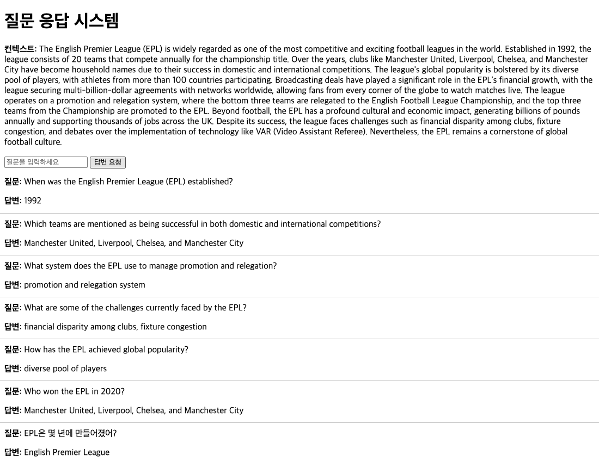

# lm-interaction-lab

이미지 캡셔닝, 텍스트 요약, 질문 응답 모델을 직접 돌려 보면서 **"사람이 이 결과를 믿고 써도 되는가"** 를 살펴본 실험 모음입니다. 정답률보다 모델이 언제, 어떻게 틀리는지와 그 오류가 사용자에게 보이는지에 초점을 두었습니다.

| 실험 | 모델 | 파일 |
|---|---|---|
| 일반 사진 캡셔닝 | `microsoft/git-base-coco` | [`notebooks/01_image_captioning.ipynb`](notebooks/01_image_captioning.ipynb) |
| 분야를 좁힌 캡셔닝 (포켓몬) | `kr-manish/git-base-pokemon` vs `git-base-coco` | [`notebooks/02_domain_captioning.ipynb`](notebooks/02_domain_captioning.ipynb) |
| 영어 텍스트 요약 | `facebook/bart-large-cnn` | [`notebooks/03_summarization.ipynb`](notebooks/03_summarization.ipynb) |
| 질문 응답 웹 페이지 | `google-bert/bert-large-uncased-whole-word-masking-finetuned-squad` | [`qa_server.py`](qa_server.py), [`qa_scores.py`](qa_scores.py) |

## 실행

```bash
python3.11 -m venv .venv && source .venv/bin/activate
pip install -r requirements.txt
python prepare_data.py            # 포켓몬 시험 그림을 data/pokemon/에 받기
# 일반 사진은 data/photos/에 jpg로 넣기 (아래 결과는 Flickr8k 샘플 8장)
jupyter notebook notebooks/
QA_CONTEXT=epl PORT=5001 python qa_server.py   # http://127.0.0.1:5001
python qa_scores.py
```

MacBook(Apple Silicon), CPU 추론, Python 3.11, transformers 4.57에서 실행했습니다. 모델 파일은 모두 합쳐 약 5GB입니다.

## 결과와 관찰

### 1. 일반 사진 캡셔닝

사진 한 장당 1.3~3.7초가 걸렸습니다. 8장 중 4장(눈밭의 개, 해변의 새, 아이들 단체 사진, 물로 뛰어드는 개)은 자연스럽고 정확했지만, 나머지에서는 그럴듯한 오류가 나왔습니다.

| 사진 | 생성된 캡션 | 문제 |
|---|---|---|
| 호랑이 옆에 앉은 아이 | a young boy is cleaning a tiger in the zoo. | 하지 않은 행동 |
| 큰 공을 굴리는 사람들 | ... a plastic bubble at the festival in london. | 사진에 없는 장소를 지어냄 |
| 서로 덤비는 개와 고양이 | a dog and a cat playing with each other. | 상황을 반대로 해석 |
| 사막의 두 사람과 자동차 | a man waving his hand while standing in the desert. | 사람 한 명, 자동차 누락 |

문장이 매끄러워서 사진을 같이 보지 않으면 오류를 알아채기 어렵습니다.

### 2. 분야를 좁힌 캡셔닝

| 데이터셋 캡션 | 포켓몬 모델 | 일반 모델 |
|---|---|---|
| a yellow and white cartoon character with a red eye | a yellow and white pokemon character with a red eye | a cartoon of a cute cartoon character. |
| a cartoon of a blue and black dragon | a drawing of a blue and black dragon | a dragon from the movie |
| a white and purple cartoon character with green eyes | a drawing of a purple and white animal | a cartoon of a rabbit |

미세조정한 모델은 색과 생김새를 구체적으로 말하지만, 같은 모델에 눈밭의 개 사진을 넣자 `a drawing of a tree with a leaf on it`이라고 했습니다. 잘하는 분야가 좁아진 만큼 그 밖에서는 크게 틀립니다. 또 데이터셋 캡션 중 하나는 노란 부리를 "red beak"이라고 적고 있어, 정답 데이터에도 오류가 있었습니다.

### 3. 텍스트 요약

| 글 | 원문 → 요약 | 빠진 내용 |
|---|---|---|
| text1 (교육과 기술) | 171 → 36단어 | 디지털 격차, 개인정보 등 뒷부분의 문제점 |
| text2 (도시화) | 177 → 36단어 | 주택 부족, 불평등과 해결책 |
| text3 (건강과 웰빙) | 193 → 43단어 | 실천 방법, 사회경제적 장벽 (`well-well-being` 반복 생성) |
| text4 (LLM, 직접 작성) | 201 → 46단어 | 글의 결론인 설계 제안 |

BART는 글 앞부분 문장을 거의 그대로 이어 붙이는 경향이 있어, `However`로 시작하는 뒷부분과 결론이 모든 글에서 빠졌습니다. 중요한 내용을 앞에 쓰는 뉴스로 학습한 모델이라, 결론이 뒤에 오는 논설문과는 맞지 않았습니다.

### 4. 질문 응답



웹 화면에는 답만 나오지만, 모델이 내는 신뢰도를 따로 뽑아 보면 이야기가 달라집니다 ([`results/qa_scores.txt`](results/qa_scores.txt)).

| 질문 | 답변 | 신뢰도 | 판정 |
|---|---|---|---|
| When was the EPL established? | 1992 | 0.99 | 정답 |
| Which teams are ... successful ...? | Manchester United, Liverpool, Chelsea, and Manchester City | 0.98 | 정답 |
| What system does the EPL use ...? | promotion and relegation system | 0.21 | 질문을 되풀이 |
| What are some of the challenges ...? | financial disparity among clubs, fixture congestion | 0.05 | 부분 정답 |
| Who won the EPL in 2020? (지문에 없음) | Manchester United, Liverpool, Chelsea, ... | 0.18 | 오답 |
| EPL은 몇 년에 만들어졌어? (한국어) | English Premier League | 0.03 | 오답 |

모델은 오답에서 스스로 낮은 신뢰도를 내고 있었지만, 화면에서는 정답과 오답이 똑같은 모습으로 보입니다.

## 정리

네 실험에서 공통으로 보인 문제는 모델이 틀린다는 사실보다 **틀렸다는 것이 사용자에게 보이지 않는다**는 점이었습니다. 이런 모델을 일상적인 인터페이스로 쓰려면 다음이 필요하다고 봅니다.

- 신뢰도가 낮을 때 그 사실을 화면에 드러내기
- 답이나 요약이 원문의 어디에서 왔는지 보여 주기
- 지문에 없거나 지원하지 않는 언어로 들어온 질문에는 모른다고 말하기
- 사용 분야와 언어에 맞춘 모델을 쓰고, 그 범위를 사용자에게 알리기

## 실행하며 겪은 것

- transformers 5.x에서는 `summarization`과 `question-answering` 파이프라인이 삭제되어 4.x로 고정했습니다.
- `bert-large-uncased-whole-word-masking-finetuned-squad`는 이제 `google-bert/` 아래에 있습니다.
- macOS는 5000번 포트를 AirPlay 수신기가 쓰므로 서버는 다른 포트로 띄웁니다.

## 데이터

시험 데이터는 저장소에 넣지 않았습니다. 포켓몬 그림은 `prepare_data.py`가 Hugging Face의 `reach-vb/pokemon-blip-captions`에서 받고, 일반 사진은 [Flickr8k](https://www.kaggle.com/datasets/adityajn105/flickr8k) 등에서 원하는 사진을 `data/photos/`에 넣으면 됩니다.
